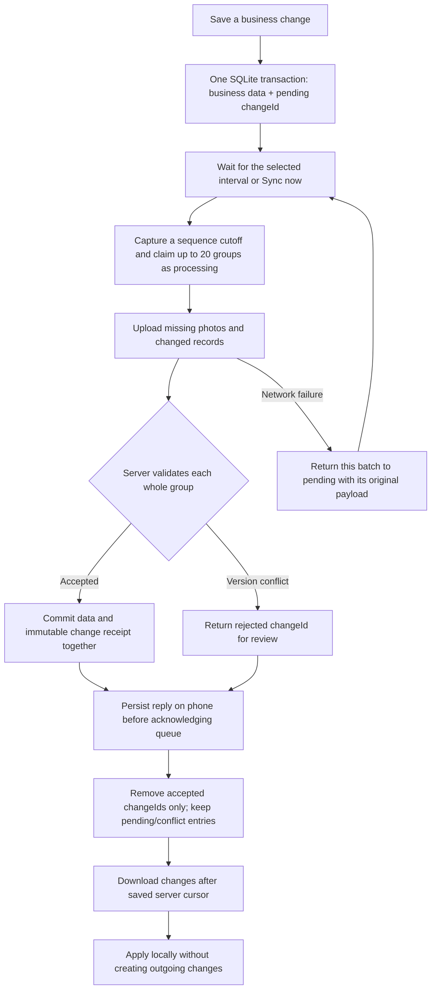

# Durable change queue — current sync flow

This is the routine cloud sync implementation authorized on 2026-10-21. It supersedes the older full-archive automatic uploader. Manual `.dokanx` export/import and reviewed full publication remain separate recovery actions.

## Local writes

- Every shared business write becomes one immutable UUID operation. A completed sale's invoice, sales history, payment and stock changes stay in the same group. They are accepted or rejected together.
- Business state and queue insert commit in the same SQLite transaction. An error rolls both back. Queue status is `pending`, `processing` or `conflict`.
- Tracking starts with one seed snapshot of existing shared records. Subsequent changes record only the changed keys and explicit deletion tombstones. Keys are stable entity IDs, not record counts or phone timestamps.
- The captured maximum sequence prevents a network request from claiming later edits. A later edit always has a different changeId, even when it changes the same product.
- First network preparation saves an immutable wire payload, including each record's prior hash. A retry reuses it exactly.
- Held Sales, unfinished sale/purchase carts and notification read markers remain on the phone. Device PINs, credentials and notification delivery IDs remain outside business sync. Manual recovery archives may still contain held carts.
- Each account has its own database. A full restore quarantines the old queue and starts a new local tracking generation after the reviewed account adoption flow.

## Scheduled exchange

- Foreground scheduler wakes every 30 seconds but starts routine exchange only when the selected interval is due (default 10 minutes, minimum 2 minutes). Manual Sync now can run immediately. Offline failure retries no sooner than two minutes, with a durable retry deadline; it never blocks a local sale.
- A request sends at most 20 business groups and only missing photo content. Backlogs drain in consecutive requests within the same scheduled run, with a maximum of 50 requests before yielding. New sales do not trigger immediate uploads.
- No-change checks may make a request to discover server changes; they do not create a new recovery version.
- Requests use account/shop ownership and server generation/cursor fences. Record hashes detect edits, including deletion and changes to old records; clock comparisons are not the authority.

## Server acceptance and recovery

- `POST /backups/:shopId/changes/operations` returns the exact batch ID, `acceptedChangeIds`, rejected IDs with status/code, and remote changes.
- Each business group validates against the complete merged business data. Valid groups accumulate in one batch transaction; independent groups may be accepted even when another group conflicts.
- Migration `006_change_receipts.sql` stores shop + changeId + originating device + payload digest atomically with acceptance. A repeated accepted request never reapplies old stock or creates another sale, even after a later edit. Reusing an ID with another payload is rejected.
- The server builds one validated recovery archive per dirty accepted batch and retains its bounded automatic history. Network transfer remains incremental.
- The phone verifies that ACK IDs match exactly the submitted IDs, then saves a durable response checkpoint before removing accepted entries. Replaying that checkpoint after a crash is safe. Unknown/missing IDs or a failed checkpoint write never clear the queue.
- Remote data uses a separate local write origin, so downloads do not echo back. New phone edits made during transfer survive application. Photos are content-addressed and verified before use.
- Server changes download on manual sync or when Automatically download changes is enabled. With it disabled, automatic runs only upload and never advance the cursor over unseen server updates.

## Conflicts and limits

- A rejected version conflict remains visible as Needs review; it does not silently choose either financial history. Only connected conflicted groups wait; independent automatic uploads/downloads continue. Existing reviewed cloud download saves a safety copy before replacement.
- Concurrent sales on the same stock record can conflict. Automatic stock-delta merging is not implemented; explicit version review handles connected business operations together.
- An accepted group is removed; a conflict group remains; a temporary rejected group remains pending. Receipt storage is retained for idempotency and needs a deliberate retention policy before production.
- A failed local apply retains the downloaded checkpoint for retry; queue acceptance and local download completion are distinct steps.
- Exact execution while an app is suspended or terminated is not promised. Reopening catches up overdue work.
- Production cloud endpoints remain disabled. This development server stores private archives on the PC; hosted storage/subscriptions/production delivery remain separate work.

## Verification

SQLite and native-adapter tests cover rollback in either half of a business save, real sale grouping, account scope, deletions, process restart, immutable retry payloads, partial acceptance, newer edits during upload, failed durable checkpoints, invalid ACKs, local-only carts and multi-request backlog draining without early scheduled sync. API integration tests cover ownership, atomic groups, lost replies, later edits and conflicting reuse of a changeId.

## User-selected interval — 2026-10-22

Cloud backup exposes an optional automatic-sync switch and a per-account/shop/device interval picker: presets 2, 5, 10, 15, 30 and 60 minutes or a custom whole-minute interval from 2 to 1440. Existing checkpoints without this preference keep ten minutes. Invalid saved intervals stop automatic work rather than running too frequently. Settings commit before their new value becomes active; failed saves preserve the prior value. Manual Sync now and the bounded continuation requests inside an active batch remain immediate. This is an automatic scheduler floor, not an HTTP rate limit on manual requests or asset uploads. Server-side traffic quotas are a separate concern. The interval survives same-shop legacy publication/adoption; it is not part of shared business data or portable .dokanx exports.

## Field comparison and explicit resolution — 2026-10-23

- Cloud backup links Needs review to a dedicated screen. It shows changed fields (quantity, price, name, nested settings and deletions), this phone/cloud values, original values when known, device identifiers and commit times. Older data without original values is labelled unknown.
- Migration 007 records accepted before/after values, hashes, source device/name and server time in the same transaction as accepted changes and receipts. Rejected operations and receipt replays add no history. `POST /changes/review` is authenticated, shop scoped and generation/cursor fenced; it returns current hashes/values, known originals and remote changes since the phone cursor. Bulk queries avoid a request per record.
- Local SQLite adds before_values to queued writes and sync_conflict_decisions for a durable audit. These are account/device queue data, not portable business or security data. Existing databases upgrade additively.
- Review groups are connected components of operations sharing record keys, so later product edits and a sale's linked stock/invoice/payment records cannot be split. Both decisions include an explicit confirmation; keeping cloud explains removal of unuploaded local transactions in that group.
- A full local safety archive is mandatory before either choice. A local SQLite transaction compares shop/generation/max sequence/exact business payload, archives the superseded operations, retires only their IDs, writes the selected data and enqueues a fresh immutable operation against the reviewed server hashes. Unrelated queued edits and phone-only carts are retained.
- The server is re-read before a choice; changed cursor/hashes require another review. A concurrent change after that fetch is caught by normal server compare-and-swap. Network failures keep the new operation pending. A failed backup or stale local write leaves the old group intact. Each resolved group can upload without waiting for other independent conflict groups.
- Accepted checkpoints are acknowledged before opening review. Unapplied incoming data is refetched from the unchanged cursor; it is not used to overwrite the user's decision. Large connected groups over 5,000 keys stop safely rather than partially resolving.
- History/audit retention and automatic reconciliation of simultaneous stock deltas remain future production work.

## Combining separate due payments — 2026-10-23

Payment-only conflict groups now offer a third explicit choice: Keep both payments. This is event union by stable settlement ID, not addition of two balance snapshots. The review also fetches the other device's new settlement records for the affected customer/supplier, so the two single-version choices represent complete branches and the combined choice retains both. Confirming phone-only warns that the displayed cloud-only payments will leave the active ledger; previous server snapshots/history remain available.

Only new immutable customerCollections/supplierPayments with a proven original party balance qualify. The local balance must equal that baseline less its recorded new payments; local party metadata edits, mixed stock/sale groups, settlement edits/deletions, unknown baselines and conflicting reuse of a payment ID disable combining. Identical IDs/values already on the server count once.

The combined balance is current cloud balance minus only the local settlement IDs not yet on the server. Existing cloud party metadata and accepted settlement records/allocations are preserved. New unuploaded local settlement amounts and identities stay intact; their bill allocations may be recomputed against current unpaid bills during explicit merge. The complete candidate validates invoice allocations, nonnegative due and cash-day records before the third button enables. Overpayments are shown for review; credit/refund amounts are never invented. Only newly uploaded local payments may be reallocated to current unpaid bills with an explicit review notice.

The new immutable wire operation includes unchanged cloud payments as compare-and-swap read guards, along with the recomputed balance and new local payments. It still uses safety archives, local sequence/payload fences, durable decision audit, server hash checks and accepted-ID receipts. Failure/retry never multiplies received money. UI shows each payment's source/time, combined payment total and resulting due.

## Independent sync during conflict — 2026-10-23

Outgoing selection computes the transitive group of pending operations sharing record keys with each conflict. Only that group is excluded; independent pending groups still claim immutable wire operations and drain normally. Accepted IDs alone are cleared. A conflict ACK is review state, not a global sync failure or automatic retry pause. Legacy adapters without durable queue support retain their fail-closed behavior.

Incoming changes are grouped by entity links (products, invoices, payments, parties, returns, batches, stock counts and closed cash-day totals). Any group intersecting an unsent/conflicted local record stays in a durable deferred delta; independent groups apply through the normal remote write path. Full business validation checks complete groups, with a bulk fast path and bounded splitting on validation failures. An unresolved group's ledger is never installed halfway.

The server cursor may advance after the phone durably stores both applied and deferred changes. Prior acknowledged hashes for protected local records remain intact; accepted writes advance their hashes even if a newer local edit already exists. Deferred deltas survive restart, coalesce by stable key and are superseded by later server values. Old received checkpoints without incoming deltas are converted from their remote/sent fingerprints when a durable queue is available.

Review refetches the current values of all deferred keys even if their revision precedes the saved cursor. A decision protects every remaining independent review group, and its replacement operation can upload immediately. Normal two-minute retry/selected-interval rules still apply to network/storage failures. This does not add per-sale uploads or automatic financial merging.

## Payment review presentation correction

Separate settlement IDs are displayed as source-labelled payment events, not opposing field columns with missing values. A combined-payment preview shows the phone's pre-payment due, each unique payment, their combined total and the resulting due. Single-party choice buttons include the remaining due for that branch. Unknown baselines or actual deletions retain explicit provenance labels rather than claiming an amount is missing. Balance fields and nested allocation amounts display BDT from stored minor units; quantities remain unscaled. This correction changes presentation only and does not rewrite saved financial records.

## Overlapping bill-allocation fix

Two offline devices can allocate separate payments against the same oldest bill even while the customer has other outstanding bills. Preserve the accepted cloud branch first, including cloud-only invoices, then replay only proven new local settlement IDs in local operation order through the existing FIFO settlement allocator. This changes their allocations, not amounts, IDs, method, reference or authored time. Already accepted cloud settlements, original invoice snapshots and other pending conflict groups remain untouched. The retired local operation audit and mandatory safety archive retain the prior allocation.

Preview reports adjusted allocations and any reconciled cloud-side due change, so an added cloud due is not mistaken for extra payment. Closed cash days stay closed and block a historical cash merge with a specific message. Overpayment/unknown baseline/edited accepted payment IDs still require review. The replacement wire operation carries recomputed local allocations and normal record-hash guards; lost ACK retries remain idempotent.
