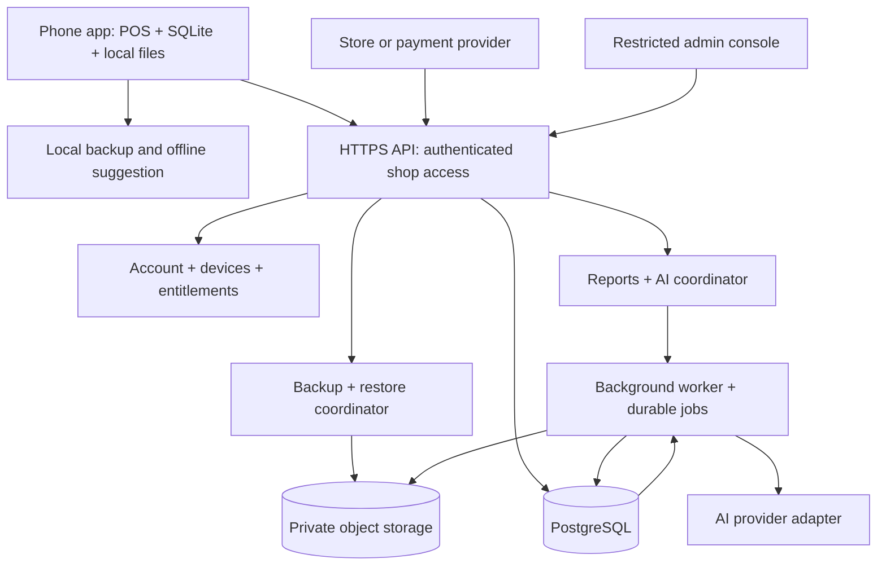

# DokanX — Server architecture ও product flow

Design draft v1 · 21 October 2026 · Review করার জন্য। Backend/app implementation-এর অনুমোদন নয়।

## 1. প্রস্তাবের মূল কথা

DokanX-এর দৈনন্দিন বিক্রি ও হিসাব ফোনে চলবে। Account, cloud recovery, subscription ও online intelligence server-এর মাধ্যমে যোগ হবে। Server unavailable বা subscription expired হলেও স্থানীয় বিক্রি, stock, বাকি, পুরোনো হিসাব, local backup/restore ও offline suggestion চলবে—এটি প্রস্তাবিত product policy, এখনো চূড়ান্ত সিদ্ধান্ত নয়।

প্রথম release-এর প্রস্তাব: প্রতি দোকানে **একটি মূল লেখার ফোন**, cloud-এ versioned backup, অন্য ফোনে recovery/transfer। একাধিক ফোনে একই সময়ে বিক্রি করার sync আলাদা পরবর্তী phase। Backup upload-কে live sync হিসেবে দেখানো যাবে না।

## 2. এখন কী আছে, কী যোগ করতে হবে

| বিষয় | বর্তমান অবস্থা | প্রস্তাবিত পরিবর্তন |
|---|---|---|
| Shop setup | Offline shopId, shopActive, নাম/মালিক/ছবি | Account-এর সঙ্গে server-owned shop binding; local setup চালু থাকবে |
| Persistence | SQLite `business_state`-এ একটি JSON payload; revision DB-তে বাড়ে | Revision API-তে প্রকাশ, consistent snapshot read, cloud checkpoint ও upload state আলাদা |
| Backup | Version 1 `.dokanx`, ছবি/QR, validation, safety backup | Cloud upload lifecycle, ownership checks, verified versions ও download |
| Restore | Assets stage করে atomic data replacement | Cloud version review, device transfer, epoch fencing; local recovery reuse |
| Reporting | স্থানীয় sales/profit/ledger logic | একই metric definitions দিয়ে cloud projections ও advanced report |
| Restock | Offline engine, editable rules/list | Authenticated provider adapter, validated fresh online result |
| AI boundary | `prediction.ts`-এ aggregate snapshot, fingerprint, timeout, validation | Backend AI jobs, quota, privacy controls, summaries |
| Security | Device-local PIN/OS authentication | আলাদা server login/session; PIN server password হবে না |
| Billing | Customer-এর sale payment method | DokanX subscription-এর সম্পূর্ণ আলাদা verified billing ledger |

## 3. Architecture diagram

প্রথম deployment: TypeScript backend (প্রস্তাব: NestJS + Fastify), একই codebase-এর API ও worker process, managed PostgreSQL, private S3-compatible object storage। Queue প্রথমে PostgreSQL-এর durable jobs/outbox হতে পারে। Redis/cache, আলাদা analytics warehouse, microservice বা Kubernetes শুরুতে বাধ্যতামূলক নয়। Provider/hosting/region/budget review-এর পরে চূড়ান্ত হবে।

API দ্রুত validation ও job creation করবে; বড় archive validation, রিপোর্ট, AI ও cleanup worker করবে। Jobs অন্তত একবার চলতে পারে ধরে idempotent করতে হবে; process crash হলে retry হবে।

## 4. Account, shop ও device

### Account flow

1. Existing offline user আগের মতো app ব্যবহার করবে। Profile → Account & Cloud-এ গিয়ে account connect করবে।
2. প্রস্তাবিত sign-in: verified phone OTP; OTP provider adapter-এর পেছনে থাকবে। OTP expiry, attempt limit, resend cooldown, per-number/IP/device rate limit লাগবে।
3. Account নতুন হলে নিজের local shop-এর review দেখাবে: shop name, ID, records, photos, local revision। User অনুমোদনের পরে cloud shop তৈরি/link হবে।
4. Account-এ shop আগে থাকলে “এই দোকান restore করুন” অথবা “এটি আলাদা দোকান”—স্পষ্ট পথ থাকবে। Matching নাম/phone/local shop ID দেখে স্বয়ংক্রিয় merge বা ownership দেওয়া যাবে না।
5. Server `cloudShopId` ও membership তৈরি করবে। পুরোনো product/invoice IDs থাকবে; server keys-এ shop namespace যোগ হবে।
6. Cloud shop binding local auth/storage metadata-তে থাকবে; imported backup থেকে account ownership, session, role বা subscription নেওয়া যাবে না।

Account = মানুষ; shop = data isolation ও billing-এর unit; device = installation/session। একটি account ভবিষ্যতে একাধিক shop-এর owner হতে পারবে। প্রথম UI এক shop দিয়ে শুরু করতে পারে।

### Roles ও recovery

| ভূমিকা | প্রস্তাবিত ক্ষমতা |
|---|---|
| Owner | Membership, cloud backup/restore, device transfer, billing, AI consent, deletion |
| Manager — পরের phase | অনুমতি পাওয়া operational report ও কাজ |
| Cashier — পরের phase | সীমিত POS; profit/backup/owner settings নয় |
| Platform support | Operational metadata; default-এ shop history/photo export নয় |

Short-lived access token এবং rotated/revocable refresh session; refresh secret SecureStore-এ। Logout হলে cloud session সরবে; offline data মুছবে কি না user-কে আলাদা স্পষ্ট পছন্দ দিতে হবে। Shared phone-এ logout মানেই data removal—এমন দাবি করা যাবে না।

নতুন device restore, ownership change ও phone change-এ fresh account verification লাগবে। SIM/phone হারালে recovery code এবং প্রস্তাবিত দ্বিতীয় recovery factor দরকার; SMS OTP একাই সব recovery ঝুঁকি সমাধান করে না। Recovery code একবার দেখানো ও server-এ hashed রাখা প্রস্তাব। Staff membership revocation server request বন্ধ করবে; ইতিমধ্যে offline রাখা data দূর থেকে নিশ্চয়তার সঙ্গে মুছে যাবে না।

Device PIN/biometric-এর secrets cloud-এ যাবে না। নতুন ফোন নিজের PIN/biometric setup করবে। Cloud role checks-ও লাগবে; শুধু app-এর profit PIN cloud authorization নয়।

## 5. Cloud backup flow

```mermaid
sequenceDiagram
  participant P as Main phone
  participant A as API
  participant S as Private storage
  participant W as Validator worker
  P->>P: Capture data + revision + referenced assets
  P->>A: Create upload (idempotency key, device epoch, size)
  A-->>P: Upload ID + scoped expiring URL
  P->>S: Upload immutable archive
  P->>A: Complete upload + expected digest
  A->>W: Durable validation job
  W->>S: Read exact uploaded object version
  W->>W: Size, hash, schema, links, assets validation
  W->>A: Mark version complete atomically
  A-->>P: Verified cloud checkpoint
```

Backup states: `created → uploading → validating → complete`, অথবা `failed/expired`। কেবল `complete` version restore করা যাবে। Progress-এ last attempt ও last successful backup আলাদা থাকবে। “সব data safe” শুধু successful captured revision পর্যন্ত; পরে হওয়া sales pending দেখাবে।

একই snapshot/job retry করলে নতুন financial records বা duplicate complete version তৈরি হবে না। Idempotency key-এর সঙ্গে payload digest মিলতে হবে; একই key-তে অন্য data reject হবে।

প্রথম cloud format-এ existing portable archive reader reuse করা যাবে। Immutable object key/upload ID এবং object version/checksum pin করতে হবে: presigned upload URL মেয়াদ থাকা পর্যন্ত reusable হতে পারে। Completion-এর পরে নতুন object bytes দিয়ে validated version বদলানো যাবে না।

Current format limits: archive 60 MB, manifest 15 MB, সর্বোচ্চ 2,000 assets, asset সর্বোচ্চ 3 MB। Cloud design এই সীমা অদৃশ্যভাবে বাড়াবে না। Quota/large upload support চাইলে streaming/multipart format ও migration আলাদা করতে হবে; পুরো বড় archive ফোনের RAM-এ ধরে রাখার design scalable নয়।

Current v1 asset hash implementation `SHA256(base64(bytes))`; নতুন raw-byte checksum চালু করলে explicit algorithm/version দিতে হবে। পুরোনো format-কে raw SHA-256 ধরে validate/deduplicate করা যাবে না।

ছবি/QR local URI হিসেবে server-এ কাজ করবে না। Portable asset IDs, bytes, size, digest থাকবে; download শেষে destination file URI তৈরি হবে। Shop photo, retained historical/held-cart photos ও QR-ও scope-এ থাকবে।

User-selected scheduling policy: প্রতি sale-এ backup নয়। Default ১০ মিনিট interval-এ app active থাকলে last successful checkpoint-এর পরে backup-যোগ্য business data/assets বদলেছে কি না পরীক্ষা করবে। পরিবর্তন না থাকলে upload/version তৈরি নয়; পরিবর্তন থাকলে সব pending পরিবর্তনের একটি consistent backup হবে। Per-sale local save চলবে, কিন্তু sale নিজে cloud upload trigger করবে না। Manual Backup Now থাকবে।

ইন্টারনেট না থাকলে pending অবস্থা থাকবে; reconnect/foreground-এ interval overdue হলে একটি catch-up check হবে, missed interval প্রতি আলাদা backup নয়। একই সময়ে একটি backup; চলাকালে হওয়া নতুন sales পরে pending থাকবে। Failure হলে capped backoff; সফল checkpoint advance শুধু validated upload-এর পরে। Timer tick বা notification read-status দিয়ে একই business snapshot বারবার upload নয়। Last checked, last successful backup ও pending changes আলাদা দেখাবে।

Wi-Fi/cellular preference পরে নির্ধারণ হবে। Phone OS background execution guaranteed নয়—app background/বন্ধ থাকলে প্রতি ১০ মিনিট delivery promise নয়; OS সুযোগ দিলে কাজ হবে এবং app খুললে overdue check হবে। Concurrent sales backup-এ আটকাবে না; snapshot captured revision পর্যন্ত consistent হবে। Missing photo হলে backup complete বলা যাবে না।

Retention প্রস্তাব: plan অনুযায়ী সফল version count/age/storage quota; latest verified recovery point কখনো নীরবে delete নয়। Abandoned uploads GC, tenant-scoped asset dedup, in-use backup/restore job-এর files GC থেকে protected থাকবে। Exact retention/GB পরে ঠিক করতে হবে।

## 6. Restore, transfer ও rollback

### নতুন ফোন

Login → নিজের cloud shops → backup list (date, last captured revision, records, size) → version review → download/stage/validate → fresh verification ও confirmation → local safety backup → atomic restore → own security setup → notification/printer reconciliation।

User-এর নতুন ফোনে আগে data থাকলে সেটা preserve/export বা restore cancel করার পথ থাকবে। প্রথম release-এ automatic merge নয়। নতুন app/unsupported schema হলে compatible version চাইবে; unknown fields silently বাদ দেওয়া যাবে না।

### একই ফোনে পুরোনো backup

পুরোনো version restore করলে তার পরের local sales হারাতে পারে—review-এ latest local/cloud checkpoint বনাম selected backup দেখাবে। Confirmation ছাড়া overwrite নয়। Safety backup তৈরি ব্যর্থ হলে destructive replacement এগোবে না। Existing stale-review protection reuse হবে; review-এর পরে নতুন sale হলে আবার review লাগবে।

### Main phone transfer

Server-এ `(shop, primaryDeviceId, dataEpoch, headCheckpoint)` থাকবে। Fresh verification-এর পরে নতুন writer promotion CAS-এ epoch বাড়াবে। পুরোনো device-এর upload/restore commits stale epoch দিয়ে latest cloud head বদলাতে পারবে না। পুরোনো ফোন আবার online হলে তার নতুন local data recovery copy হিসেবে export/review করতে পারবে; overwrite বা silent discard নয়।

Epoch server protection; offline পুরোনো ফোনে বিক্রি physically বন্ধ করানোর নিশ্চয়তা নয়। Transfer warning-এ পুরোনো ফোন ব্যবহার বন্ধ করতে বলতে হবে। দুটো ফোনই offline-এ কাজ করলে পরে manual recovery লাগে—এটাই প্রথম phase-এর সীমা।

পুরোনো checkpoint restore একটি নতুন lineage/epoch তৈরি করবে; normalized reports-এর active generation-ও পরিবর্তিত হবে। পুরোনো outbox/upload পুনরায় এসে restored history-তে records ঢুকিয়ে দিতে পারবে না। Backup history এবং subscription ledger মুছে যাবে না।

Customer restore এবং server disaster recovery আলাদা। Operator-কে database PITR, object retention ও restore drill রাখতে হবে; customer archive থাকলেই platform database recoverable হয় না।

## 7. Advanced reports: আগে নির্ভুল হিসাব

প্রথম cloud reports শেষ verified backup পর্যন্ত। UI-তে `Data as of`, backup revision, shop timezone ও data quality দেখাবে; local current report বেশি সাম্প্রতিক হলে সেটা পরিষ্কার থাকবে।

Archive validation শেষ হলে worker immutable report generation তৈরি করবে: canonical invoices, invoice lines, returns, collections, supplier payments, expenses, stock movements, batches ও settings-এর normalized projection। সম্পূর্ণ নতুন generation তৈরি হওয়ার পরে active pointer atomically বদলাবে। পুরোনো cumulative snapshot append করে একই sale আবার count নয়।

Money BDT minor units-এ integer; quantity canonical unit + scaled ticks/decimal-এ। Piece, kg, litre মিশিয়ে মোট quantity নয়। Historical retail/wholesale prices, costs, discounts, taxes ও returns-এর snapshot অপরিবর্তিত থাকবে।

| Report | দেখাবে |
|---|---|
| Sales comparison | Day/week/month, আগের period, wholesale বনাম retail, returns |
| Profit | Sale/line historical price ও cost, margin, gross বনাম expense-adjusted result |
| Collections/cash | Sale revenue বনাম টাকা হাতে আসা; due collection নতুন sale নয় |
| Receivables/payables | Customer/supplier balance, ageing, collections, optional promised dates |
| Inventory | Stock, low stock, ageing, expiry, count adjustments, slow/dead stock |
| Product trends | Quantity within unit, revenue, frequency, stockout evidence |
| Purchase | Supplier, costs, pending receipt, payments, lead-time evidence |

Shared versioned metric package local/server-এর golden test cases দিয়ে reconcile করবে। Return date-এ netting, partial refund, tax ও zero revenue margin-এর নিয়ম লিখতে হবে। Current local legacy sales যেগুলোর movement নেই, সেগুলো projection-এ explicit legacy treatment পাবে; তথ্য বানানো যাবে না।

Shop reporting timezone owner বেছে নেবে; ফোন নিয়ে ভ্রমণ করলে স্বয়ংক্রিয়ভাবে shop day বদলাবে না। Historic records-এ timezone metadata সীমিত—migration assumption review-এ দেখাতে হবে। UTC timestamps থাকবে; timezone/rule version বদলালে report definition version বদলাবে, historical receipt timestamp নয়।

বড় report async job → ready → signed download (PDF/CSV) হতে পারে। CSV export-এ spreadsheet formula injection প্রতিরোধ লাগবে। Report job ও cache key-তে shop, epoch, generation, period, filters, permission scope ও metric version থাকবে।

## 8. AI summary

Flow: user period বাছবে → authorized report metrics → consent + entitlement/quota check → AI job → validated summary → data-as-of ও supporting report links।

AI নতুন financial total হিসাব করবে না। Server deterministic metrics তৈরি করবে; AI সেগুলো বাংলায়/ইংরেজিতে বোঝাবে: কী বদলেছে, কোন products/categories অবদান রেখেছে, কোন দিক খেয়াল করা যায়। প্রতিটি numeric claim approved metric ID-র reference করবে; final numeric values app/server render করবে। Invalid/unsupported claim বাদ পড়বে; model output schema-valid হলেই সত্য বলে ধরা যাবে না।

Input-এ customer/owner name, phone, address, wallet numbers, QR, photo, PIN, login secrets থাকবে না। Product alias ব্যবহার করা যাবে; UI local name মেলাবে। Tenant data অন্য shop-এর prompt/cache-এ যাবে না। Product notes/names-এর instruction untrusted data হিসেবে ধরতে হবে; model-এর কাছে arbitrary DB/HTTP/write tools থাকবে না।

Insufficient period/partial backup হলে summary সেই সীমা বলবে। Provider failure হলে deterministic summary fallback; user-এর ব্যবসার data পরিবর্তন নয়। Consent version ও provider/data-processing policy record করতে হবে; default-এ cross-shop training/data resale নয়। Provider-এর actual retention terms বাছার পরে review করতে হবে।

## 9. AI product suggestion

প্রথম scope existing catalogue-এর restock planning। নতুন অজানা product, supplier stock বা market demand-এর নিশ্চয়তা নয়। Assortment/new product recommendation চাইলে market/catalogue data ও আলাদা consent/source design লাগবে।

Flow: বর্তমান offline estimate → user online AI consent → authenticated aggregate snapshot → server schema/limits/entitlement → forecast job → bounded structured proposal → current fingerprint check → Local vs Online compare → user edit → explicit apply to buy list।

বর্তমান `PredictionSnapshot v1` identity-free payload reuse হবে। এটি on-demand current local aggregates দিয়েও চলতে পারে; online suggestion-এর জন্য প্রতিবার পুরো archive upload বাধ্যতামূলক নয়। Payload client observation, server-verified financial truth নয়; এটাকে report/billing ledger-এ লেখা যাবে না।

প্রস্তাবিত computation: local baseline + forecasting/statistical service + bounded adjustments; LLM explanation দিতে পারে। LLM-এর unverified arithmetic দিয়ে quantity নির্ধারণ নয়। Lead time, target days, stockouts, returns, pending orders, expiry, pack size, max quantity ও budget constraints enforce করতে হবে।

Version 1 snapshot purchase costs পাঠায় না; server একা exact money-budget verify করতে পারবে না। Local validator-এর cost/budget check থাকবে। Server-authoritative budget চাইলে cloud projection-এর matching cost revision বা নতুন explicitly consented aggregate cost contract দরকার—সেটি v2 decision।

বর্তমান validator low-data/manual rows-এর AI quantity reject করে; v1-এ এটাই থাকবে। Low-data forecasting খুলতে হলে eligibility/confidence rules ও tests আলাদা review করতে হবে। User-edited quantities auto overwrite নয়। AI output সরাসরি purchase, stock movement, supplier message বা payment তৈরি করবে না।

Async job protocol `POST → 202 jobId → status/result`; mobile adapter bounded polling/cancellation করবে। বর্তমান 8-second default/30-second maximum call budget blindভাবে বাড়ানো নয়। Deadline পেরোলে local result থাকবে; server cancellation best-effort এবং quota accounting consistent হবে।

Cache/dedup key: shop + fingerprint + provider/model/prompt/schema/rule versions + language। Result expiry ও current fingerprint check আগের মতো থাকবে। Out-of-order response, changed stock/cost/unit, timeout বা invalid result হলে offline fallback।

Quality: backtest forecast error, stockout rate, wastage, manual overrides ও realized demand দিয়ে যাচাই; online AI যে baseline-এর চেয়ে ভালো হবে, আগেই প্রতিশ্রুতি নয়।

## 10. Subscription ও payment flow

User-confirmed policy: subscription সম্পূর্ণ cloud-based। Offline-এ unlimited products এবং স্থানীয় কাজ চলবে। Cloud tier product limit উদাহরণ ১০০ / ৫০০ / ১,০০০; price ও tier names এখনো চূড়ান্ত নয়। Limit-এর বেশি offline catalogue থাকলে partial cloud archive-কে complete backup বলা যাবে না—upload paused/upgrade-required দেখাবে; last verified backup অক্ষত থাকবে। Product count-এর পাশাপাশি storage, retained versions ও AI quota লাগবে; count rules পরে নির্ধারণ হবে।

প্রস্তাবিত subscription scope **প্রতি shop**; phone প্রতি আলাদা charge নয়। Seat/device limits ও multi-shop discount পরে নির্ধারণ হবে। সব capability server entitlements-এ; app-এর local boolean paid access দিতে পারবে না।

| Proposed tier | Access |
|---|---|
| Local | Existing offline POS/history, local backup/restore, offline suggestion |
| Backup | Local + cloud backup, version history, device recovery; storage/retention limits |
| Smart | Backup + cloud advanced reports, AI summary ও online suggestions; monthly usage quota |

নাম, price, quota, trial days, storage ও grace period এখন প্রস্তাব; hardcoded final নয়। আগে অর্থনীতি ঠিক করতে হবে।

### Billing flow

Plan screen → distribution-appropriate checkout → server verifies provider transaction → durable provider event → subscription state → entitlements → app refresh। Client success page, QR screenshot বা user-entered transaction ID paid activation-এর প্রমাণ নয়।

Google Play/App Store-এ digital feature subscription-এর purchase flow তাদের applicable billing rules অনুসরণ করবে; allowed exception/region eligibility review না করে in-app bKash/Nagad checkout বসানো যাবে না। Direct Android distribution/web-এর জন্য supported merchant gateway আলাদা adapter হতে পারে। আজকের shop bKash/Nagad QR কেবল customer sale payment display—DokanX subscription verification নয়।

Backend provider-specific states রাখবে, তারপর normalized `pending`, `trialing`, `active`, `grace`, `on_hold`, `cancelled_until_period_end`, `expired`, `revoked/refunded` capability নির্ধারণ করবে। Cancel মানেই সঙ্গে সঙ্গে paid period বন্ধ নয়; refund/revocation আলাদা। Provider API/store verification source of truth; webhook পেলেই blindly active নয়।

Webhook authentication/signature যাচাই; `(provider,eventId)` unique; purchase token/order একটি shop/account-এ একবার bind; out-of-order event-এর পরে latest provider state fetch; scheduled reconciliation missed webhook সামলাবে। Purchase acknowledgement/restore-purchases store-specific নিয়মে হবে। Billing history customer business snapshot restore দিয়ে rollback হবে না।

### Expiry ও offline policy

প্রস্তাব: local কাজ ও existing data export চলবে। New cloud uploads/AI generation plan অনুযায়ী বন্ধ; paid-generated পুরোনো report পড়া বন্ধ নয়। Existing backups download/restore retention window-এ allow করা ভালো; data ফেরত পেতে পুনরায় subscription কিনতে বাধ্য নয়। Retention window, expiry notifications, deletion এবং unpaid storage cost এখনও সিদ্ধান্তসাপেক্ষ।

App signed entitlement snapshot last-known state দেখাতে পারে; server-side cloud APIs সবসময় live authorization করবে। Cached state edit/phone clock পিছিয়ে cloud access বা নতুন trial পাওয়া যাবে না। Optional offline premium features ভবিষ্যতে থাকলে bounded signed lease ও its limits আলাদা policy হবে।

AI quota job acceptance-এ atomically reserve, successful job-এ finalize, failed/cancelled job-এ policy অনুযায়ী release; retry একই reservation। Real provider cost সব attempts-এর জন্য আলাদা track হবে। Per-shop/day/provider spend cap, output/input limits ও global kill switch দরকার।

## 11. Database boundaries

| Tables/domain | Key data ও invariant |
|---|---|
| users, auth_identities, recovery_factors | Verified identity; OTP/recovery secrets plaintext নয় |
| shops, shop_memberships | Server shop ownership, roles; shopId জানা access নয় |
| devices, sessions | Revocable installation/session, owner link, writer status |
| shop_heads | Primary device, epoch, committed revision, active report generation; CAS updates |
| backup_uploads, backup_versions, assets | Lifecycle, immutable object version, schema/hash, counts, tenant scope |
| restore_sessions | Chosen checkpoint, destination, expected epoch, expiry, status |
| report_generations, normalized projections | Composite tenant+epoch+source IDs, historical amounts, generation watermark |
| report_jobs, ai_jobs | Inputs/version/fingerprint, state, output reference, expiry |
| plans, subscriptions, subscription_events | Provider-authoritative billing; business restore থেকে আলাদা |
| entitlements, quota_reservations, usage_ledger | Atomic quota, provenance, effective periods |
| jobs, outbox, idempotency_records | Durable retries; request digest and committed result |
| consent_records, audit_events | Actor, purpose, version, action; redact sensitive content |

সব tenant-owned row-এ `cloud_shop_id` ও composite foreign keys। API membership/role check এবং PostgreSQL RLS দুটোই থাকবে; connection pool-এ transaction-local tenant context, background worker-এ explicit tenant scope। Application role table-owner/BYPASSRLS হবে না। Object paths-এর UUID security boundary নয়; প্রতিটি sign/download operation-এ authorization লাগবে।

Account deletion, shop deletion, subscription cancellation এবং local-only erase আলাদা actions। Shared ownership থাকলে delete-before-transfer policy review করতে হবে। Export, fresh verification, explicit cloud-data deletion scope, scheduled purge এবং backup expiry notice দরকার; device snapshots থেকে server session/consent restore হবে না।

## 12. API outline — contracts পরে চূড়ান্ত হবে

| Area | Proposed endpoints |
|---|---|
| Account | `/v1/auth/otp/start`, `/verify`, `/refresh`, `/logout`, `/me`, recovery |
| Shop | `/v1/shops`, `/shops/{shop}/members`, `/devices`, `/transfer-sessions` |
| Backup | `/shops/{shop}/backup-uploads`, `/{upload}/complete`, `/backups`, `/{backup}` |
| Restore | `/shops/{shop}/restore-sessions`, `/{restore}/confirm`, download authorization |
| Reports | `/shops/{shop}/reports`, `/report-jobs/{job}`, export |
| AI | `/shops/{shop}/ai/summaries`, `/restock`, `/ai-jobs/{job}`, cancellation |
| Billing | `/shops/{shop}/entitlements`, `/subscription`, `/checkout`, `/restore-purchases` |
| Webhooks | `/v1/webhooks/billing/{provider}` — separate provider authentication |

Common response: requestId, state, capturedRevision/dataEpoch, dataAsOf, schema/metric version, retryable error code। Cursor pagination, request size limits, idempotency headers, job ownership, finite timeouts ও cancellation লাগবে। Upload credentials phone-এ permanent storage credentials নয়। Server fresh auth/permission checks restore confirmation ও download signing-এ আবার করবে।

## 13. Multi-device simultaneous sales — পরের phase

Primary-device backup design একাধিক writer support করে না। প্রয়োজন হলে normalized local tables বা transactional command log + outbox যোগ করতে হবে। Command commit এবং outbox insert একই SQLite transaction; existing `BusinessProvider.update` callback-এর বাইরে side effect দিয়ে queue লেখা যথেষ্ট নয়।

প্রতি command-এ operation ID, shop/epoch/device, device sequence, base version ও schema version; server processed-operation key unique, validation transaction, pull cursor এবং tombstone acknowledgements থাকবে। Upload retry মানে effectively-once domain effect; transport exactly-once দাবি নয়।

| Conflict | প্রস্তাবিত নীতি |
|---|---|
| Invoice/payment/return | Immutable append + unique ID; edit correction/void event দিয়ে |
| Product metadata | Optimistic version; conflicting edit review; silent money overwrite নয় |
| Stock | Movement-derived balance; absolute stock last-write-wins নয় |
| Offline simultaneous sale | Global oversell prevention সম্ভব নয়; stock allocation, offline limit বা reconciliation business policy বেছে নিতে হবে |
| Customer balance | Ledger-derived; client balance number blindly overwrite নয় |
| Open/held cart | Device ownership; explicit transfer/review |
| Settings | Versioned policy; owner precedence where appropriate |

Conflict UX, migration, negative stock handling ও owner resolution approve না হওয়া পর্যন্ত দ্বিতীয় sales device advertise করা যাবে না।

## 14. Operations, security ও failure cases

- Environments: local/test, staging/sandbox, production; separate databases, buckets, credentials ও billing products। Real customer data staging-এ copy default নয়।
- TLS, private buckets, encrypted database/object storage with managed keys, secret manager, restricted network access, admin MFA ও audited support access।
- Cloud reports/AI opt-in processing-এর জন্য server data decrypt/process করতে পারবে। এটিকে end-to-end/zero-knowledge encryption বলা যাবে না। E2EE backup চাইলে recovery-key custody ও server report/AI tradeoff আলাদা design হবে।
- App/device tokens, PIN keys, OTPs, wallet QR contents বা raw AI prompts logs-এ নয়। Provider API key শুধু server-এ। Presigned URLs bearer credentials হিসেবে short-lived ও redacted থাকবে।
- Metrics: backup success/age, validation failure, queue age, report lag, restore success, billing reconciliation mismatch, AI spend/latency/fallback rate। Alert routing ও incident runbook থাকবে।
- Database PITR ও independent retained object versions; encrypted backup keys-এর recovery permission-ও পরীক্ষা করতে হবে। প্রস্তাবিত production target RPO ≤15 min, RTO ≤4 h; provider/retention cost ও drill পাস না হওয়া পর্যন্ত SLA নয়।
- Client data-loss window = last completed phone backup পর্যন্ত; server RPO দিয়ে তার পরে offline sales ফেরত পাওয়ার প্রতিশ্রুতি নয়।
- Deployment: backward-compatible API/schema, expand/migrate/contract DB changes, worker version compatibility, staged mobile rollout, feature flags, rollback।
- Restore drill: wrong account, tampered archive, missing photo, newer schema, network break, full storage, stale review, old primary upload, interrupted DB commit ও deleted account।
- Billing drill: replayed/spoofed/out-of-order webhook, purchase bound twice, refund, cancel before expiry, failed renewal, missed event, device clock rollback।
- AI drill: timeout, model outage, malformed/unsafe quantity, prompt injection, cross-shop cache attempt, stale fingerprint, duplicated job, quota race, partial report।

## 15. App-এ পরিবর্তনের মানচিত্র

| Area | Planned change |
|---|---|
| Profile | Account & Cloud, Backup & Restore, Devices, Subscription, AI permissions/usage |
| Setup | Existing offline setup + optional account connect; restoring existing shop-এর আলাদা entry |
| Repository | Revision-aware consistent snapshot/checkpoint interface; existing business writes ফোনেই |
| Backup screen | Local file বনাম cloud versions, status, quota, latest successful revision, restore review |
| Device metadata | Cloud binding, epoch, primary status, session; business export থেকে authority আলাদা |
| Reports | Local/current বনাম cloud/data-as-of, filters, comparisons, export ও AI summary action |
| Restock | Current provider boundary connect; source/compare/manual edit/fallback রাখা |
| Security | Fresh cloud account verification sensitive server action-এ; device lock local থাকবে |
| Build | Compatible native development/release client; notifications/billing/device support আলাদা device QA |

বর্তমান `shopActive` শুধু local onboarding state। এটিকে subscription status, remote suspension বা server authorization হিসেবে ব্যবহার করা যাবে না। App entry-তে offline কাজ চলবে; paid cloud screen-এ entitlement check হবে।

## 16. বাস্তবায়নের প্রস্তাবিত ক্রম

1. Decisions ও UX approve: account identity/recovery, primary-device scope, data retention/processing, billing channel, budget।
2. Account + tenant isolation + device/session + versioned cloud backup/restore; প্রথমে এই recovery flow-এর device tests।
3. Subscription verification/entitlements + storage quota/retention; paid public rollout-এর আগে। Staging entitlement দিয়ে আগের phase পরীক্ষা করা যাবে।
4. Shared metric definitions + normalized projection + advanced report; local totals reconciliation।
5. AI summary + quota/spend controls + deterministic fallback।
6. Online restock forecast adapter + comparison/acceptance + quality backtest।
7. প্রয়োজন নিশ্চিত হলে multi-device sync ও staff operations।

## 17. পরের আলোচনায় সিদ্ধান্ত

| সিদ্ধান্ত | Draft recommendation |
|---|---|
| Login বাধ্যতামূলক? | Offline কাজের জন্য নয়; cloud/online services-এর জন্য |
| Subscription-এর unit | প্রতি shop |
| প্রথমে একাধিক sales phone? | এক primary writer + transfer; multi-writer পরে |
| Account recovery | Verified phone + separate recovery factor/code |
| Distribution/payment | Play/App Store বনাম direct APK/web আগে বেছে applicable checkout |
| Paid expiry | Local data/কাজ থাকবে; recovery access ও retention policy প্রকাশিত |
| Cloud data processing | Encrypted storage, authorized server processing; AI-তে minimal aggregates |
| AI provider | Adapter; privacy, Bangla quality, cost ও latency পরীক্ষা করে নির্বাচন |
| Plan limits | Price, storage, versions, AI quota, trial/grace এখনো অনির্ধারিত |
| Hosting | Managed DB/object storage; region, user count, average data ও monthly budget মেপে নির্বাচন |

Cost planning-এ active shops × average archive size × retained versions, photo change rate, restore/download traffic, OTP requests, report worker time, AI input/output/request frequency এবং operational recovery cost ধরতে হবে। কোন volume না জেনে নির্দিষ্ট monthly bill বা unlimited AI প্রতিশ্রুতি দেওয়া ঠিক হবে না।

## 18. যাচাই করা primary references

- Tenant isolation: [PostgreSQL row security](https://www.postgresql.org/docs/17/ddl-rowsecurity.html), [OWASP object authorization](https://api-security.owasp.org/editions/2023/en/0xa1-broken-object-level-authorization/)।
- File access/recovery: [S3 presigned URLs](https://docs.aws.amazon.com/AmazonS3/latest/userguide/using-presigned-url.html), [object versioning](https://docs.aws.amazon.com/AmazonS3/latest/userguide/Versioning.html), [PostgreSQL PITR](https://www.postgresql.org/docs/17/continuous-archiving.html)।
- Mobile billing: [Google Play payments policy](https://support.google.com/googleplay/android-developer/answer/9858738), [subscription lifecycle/backend verification](https://developer.android.com/google/play/billing/lifecycle/subscriptions), [Apple review guidelines, payments/account deletion](https://developer.apple.com/app-store/review/guidelines/)।

References নকশার constraints বোঝাতে ব্যবহার করা হয়েছে; নির্দিষ্ট hosting/payment/provider contract বা store approval নিশ্চিত করা হয়নি। Shipping-এর আগে applicable region/store policy আবার যাচাই করতে হবে।
